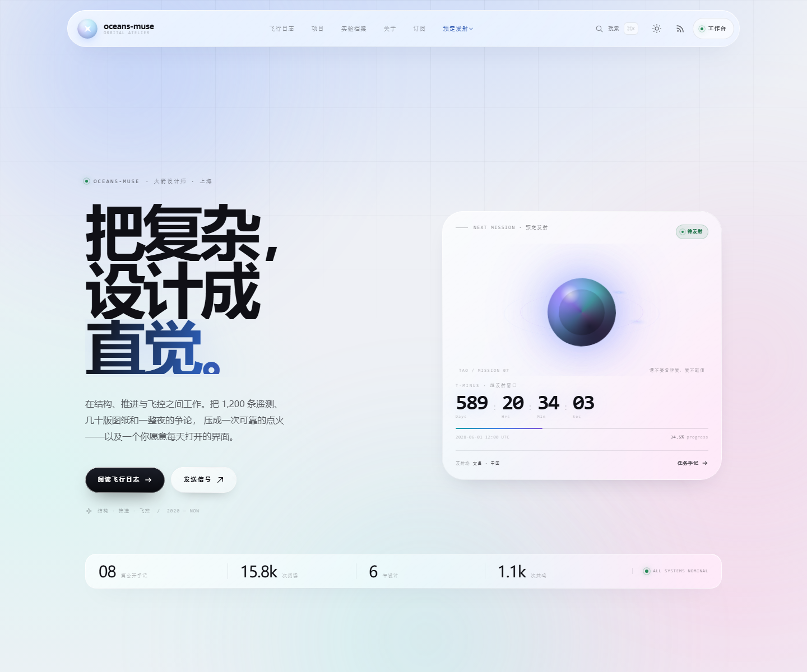
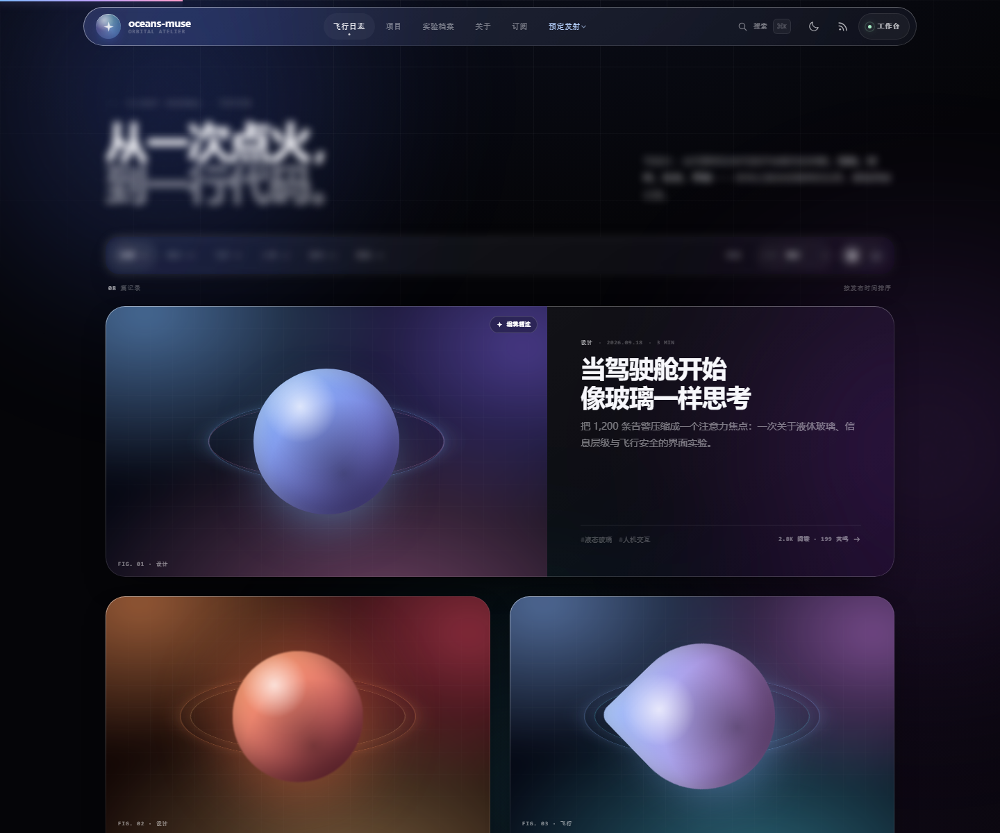
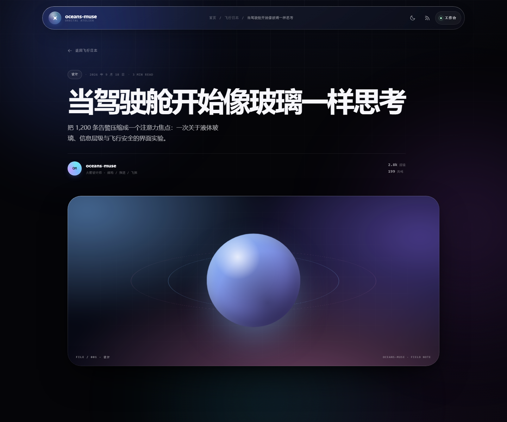
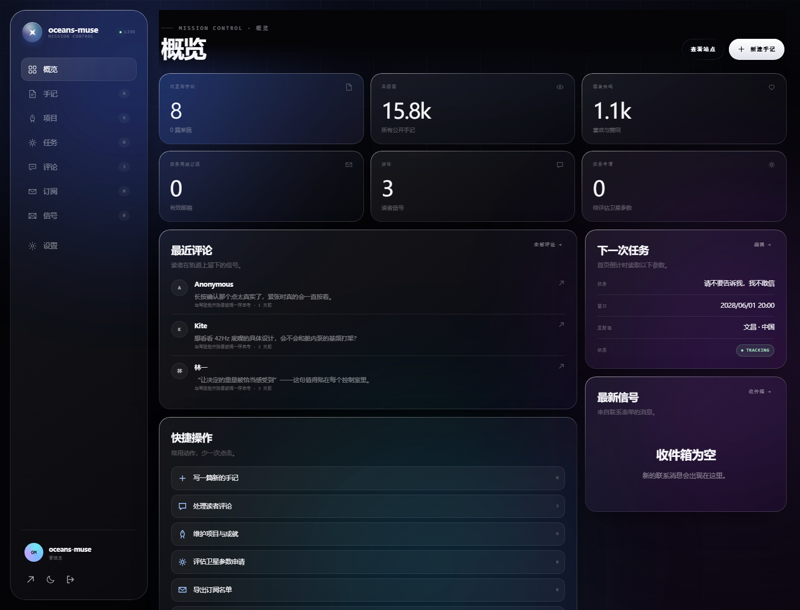
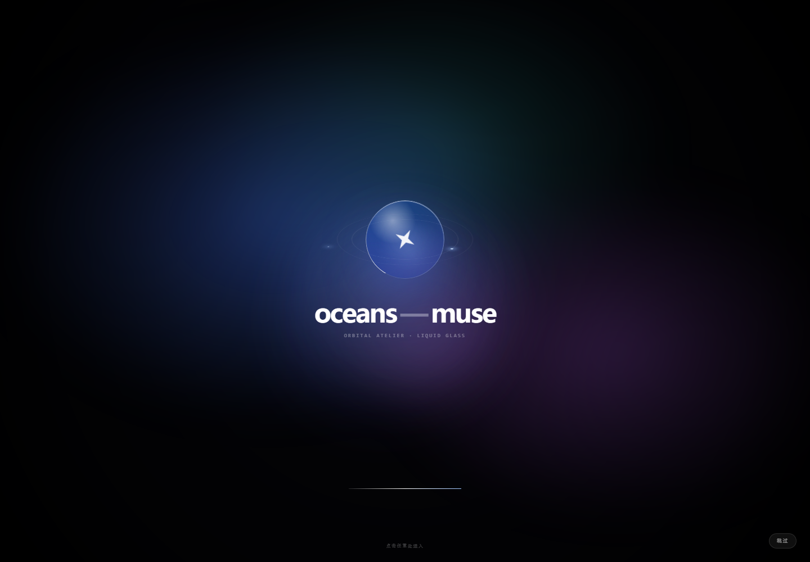
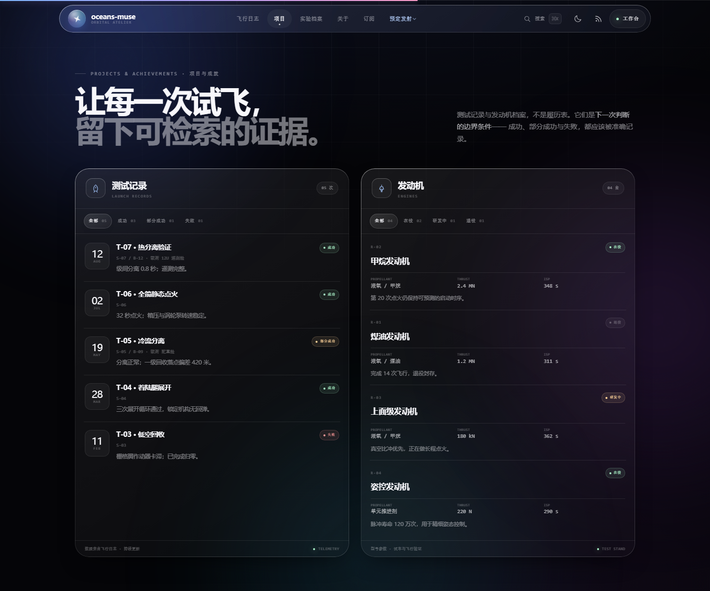
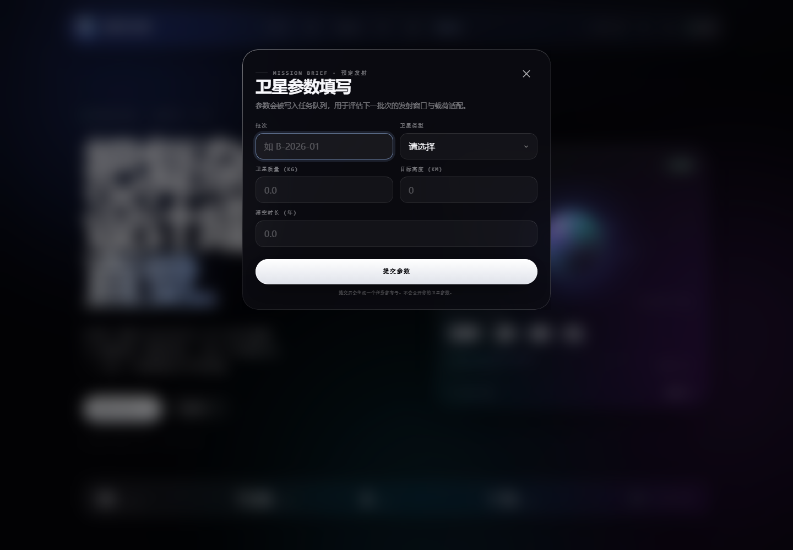

# oceans-muse · Liquid Glass Blog

> 把复杂的系统，设计成透明的直觉。

一个**可直接运行的全栈个人博客**：以原 `index.html` 的航天编辑气质为起点，重构为 Apple Liquid Glass 视觉语言，补齐真正的文章系统、评论、订阅、联系消息、搜索、RSS、管理后台与数据库持久化。

没有构建步骤，没有前端框架，没有第三方运行时依赖。Node.js 负责 HTTP、鉴权与 SQLite，浏览器负责全部交互。



| 飞行日志 | 文章阅读 |
| --- | --- |
|  |  |

| 工作台 | 开屏动画 |
| --- | --- |
|  |  |

| 项目与成就 | 预定发射 |
| --- | --- |
|  |  |

---

## 快速开始

需要 **Node.js 24+**（推荐 24），因为使用了内置的 `node:sqlite`。

```bash
npm start
```

打开 **http://127.0.0.1:4310**

首次启动会自动创建 `data/blog.db`，并写入 8 篇示例手记、3 条评论、5 条测试记录、4 台发动机与站点设置。

| 项目 | 值 |
| --- | --- |
| 站点 | http://127.0.0.1:4310 |
| 工作台 | http://127.0.0.1:4310/admin |
| 初始账号 | `admin` |
| 初始密码 | `liquid-glass-2026` |

> 登录后请立即在「设置 → 账户安全」中修改密码。只有数据库为空时才会使用初始凭据。

其他命令：

```bash
npm run dev     # node --watch，本地开发
npm test        # 完整 API / 页面 / 安全头集成测试
```

首次进入会有一次可跳过的液体玻璃开屏动画。调试时可用：

- `?splash=1` 强制播放
- `?splash=0` 跳过
- `?theme=dark` / `?theme=light` 强制主题（不写入本地偏好）

---

## 它包含什么

### 公开站点

- **首页**：大字号编辑式 Hero、任务倒计时、动态站点统计、项目档案、关于、任务简报订阅。
- **飞行日志**：分类筛选、最新/最早/最受欢迎排序、网格/列表布局、分页加载、骨架屏与空状态。
- **项目与成就**：测试记录与发动机档案双面板，按成功/部分成功/失败与在役/研发中/退役筛选，数据持久化。
- **预定发射**：导航中的卫星参数弹窗，批次、类型、质量、高度、滞空时长提交后进入后台任务队列。
- **搜索**：`⌘K` / `Ctrl K` / `/` 打开液态玻璃搜索面板，实时请求、键盘上下选择、回车打开。
- **文章页**：服务端 Markdown 渲染、自动目录、阅读进度、代码块复制、点赞（防重复）、评论、分享、相关阅读、上一篇/下一篇。
- **阅读体验**：暗/亮双主题、`prefers-reduced-motion`、`prefers-reduced-transparency`、强制色彩模式、跳转链接、键盘焦点。
- **内容出口**：RSS `/feed.xml`、站点地图 `/sitemap.xml`、`robots.txt`、PWA manifest。
- **联系**：首页「发送信号」弹窗，内容写入数据库，可在后台查看。

### 工作台（/admin）

- 登录 / 退出，基于 scrypt 的密码哈希与服务端会话。
- **概览**：发布数、阅读、共鸣、订阅、评论、未读消息，最近评论与最新信号。
- **手记管理**：新建、编辑、删除、草稿/发布、精选、封面风格、标签、发布时间。
- **项目与成就**：测试记录 / 发动机档案的新增、编辑、删除与状态维护。
- **卫星参数申请**：查看载荷参数、标记已评估/已关闭、删除申请。
- **Markdown 编辑器**：实时服务端预览、字数/阅读时长、`⌘S` 保存。
- **评论管理**：显示 / 隐藏 / 删除。
- **订阅管理**：查看、复制邮箱、导出 CSV、移除。
- **消息收件箱**：未读 / 已读 / 归档 / 删除。
- **站点设置**：站点文案、关于信息、任务倒计时、简报文案、GitHub 链接。
- **账户安全**：修改密码并注销全部会话。

### 后端

- 零依赖 Node HTTP 服务；内置 `node:sqlite`（WAL 模式）。
- 文章、评论、点赞、订阅、联系消息、设置、用户、会话全部持久化。
- `scrypt` 密码哈希、HttpOnly / SameSite 会话 Cookie、SHA-256 会话令牌。
- 登录、点赞、评论、订阅、联系接口限流。
- 同源校验、CSP、`nosniff`、`X-Frame-Options: DENY`、Referrer Policy、路径穿越防护。
- 服务端 Markdown 渲染默认转义原始 HTML，链接协议白名单。
- 动态 RSS / Sitemap / Post 页面 SEO Meta / `noscript` 摘要。

---

## 技术栈

| 层 | 选择 |
| --- | --- |
| Runtime | Node.js 24（`>=24`） |
| 数据库 | `node:sqlite`，WAL |
| 后端 | 原生 `node:http`，无框架 |
| 前端 | 原生 ES Modules、CSS、HTML |
| 构建 | 无 |
| 依赖 | 无 |

选择零依赖不是炫技，而是为了这个项目可以被直接打开、理解、修改和部署。所有关键逻辑都在 `server.js`、`lib/` 和 `public/assets/` 里。

---

## 项目结构

```text
.
├── server.js                 # HTTP 服务、路由、鉴权、RSS/Sitemap、静态资源
├── lib/
│   ├── db.js                 # 数据库初始化、查询、事务与内容模型
│   ├── seed.js               # 示例手记、默认管理员与站点设置
│   ├── auth.js               # scrypt、会话、Cookie
│   └── markdown.js           # 安全 Markdown 渲染、目录、阅读时长
├── public/
│   ├── index.html            # 首页
│   ├── post.html             # 文章模板（服务端注入 SEO Meta）
│   ├── admin.html            # 工作台
│   ├── 404.html
│   ├── manifest.webmanifest
│   └── assets/
│       ├── css/              # base / home / post / admin
│       ├── js/               # theme / boot / api / ui / home / post / admin
│       └── media/            # favicon、OG 图
├── data/blog.db              # 首次启动自动生成（已加入 .gitignore 的数据库文件）
├── tests/api.test.js         # 集成测试
├── legacy/index.html         # 原始单页，保留作视觉对照
├── qa/                       # 本地无头浏览器截图工具（开发辅助）
└── docs/                     # README 预览图
```

> `data/blog.db` 默认不提交版本库；当前工作区中已经生成了一份带示例内容的数据库，直接 `npm start` 即可看到完整站点。

---

## 配置

复制 `.env.example` 为 `.env`，或直接使用环境变量。

| 变量 | 默认 | 说明 |
| --- | --- | --- |
| `PORT` | `4310` | 监听端口 |
| `HOST` | `127.0.0.1` | 监听地址；局域网/容器可设 `0.0.0.0` |
| `ADMIN_USER` | `admin` | 首次启动创建的管理员账号 |
| `ADMIN_PASSWORD` | `liquid-glass-2026` | 首次启动密码；之后以数据库为准 |
| `IP_SALT` | 本地占位值 | 评论/限流 IP 哈希盐，生产必须更换 |
| `SITE_ORIGIN` | 请求 Host 推导 | RSS / Sitemap / canonical 的公开 origin |
| `COOKIE_SECURE` | 未设置 | 置于 HTTPS 反代后设为 `1` |
| `TRUST_PROXY` | 未设置 | 信任 `X-Forwarded-For` 时设为 `1` |

示例：

```bash
# .env
PORT=4310
ADMIN_PASSWORD=replace-with-a-long-password
SITE_ORIGIN=https://blog.example.com
IP_SALT=replace-with-32-random-bytes
COOKIE_SECURE=1
TRUST_PROXY=1
```

---

## API 速览

所有响应为 `{ ok: true, data }` 或 `{ ok: false, error: { code, message } }`。

### 公开

| 方法 | 路径 | 用途 |
| --- | --- | --- |
| GET | `/api/health` | 健康检查 |
| GET | `/api/meta` | 设置、统计、分类、标签 |
| GET | `/api/posts?q=&category=&tag=&sort=&limit=&offset=` | 文章列表 |
| GET | `/api/posts/:slug` | 文章详情（含 HTML、目录、相关、上下篇、点赞状态） |
| POST | `/api/posts/:slug/like` | 点赞 / 取消点赞（visitor cookie 去重） |
| GET/POST | `/api/posts/:slug/comments` | 评论列表 / 发布评论 |
| POST | `/api/subscribe` | 订阅任务简报 |
| POST | `/api/contact` | 联系消息 |
| GET | `/api/projects` | 测试记录与发动机档案 |
| POST | `/api/mission-requests` | 提交卫星参数申请 |

### 鉴权与后台

| 方法 | 路径 | 用途 |
| --- | --- | --- |
| POST | `/api/auth/login` | 登录 |
| POST | `/api/auth/logout` | 退出 |
| GET | `/api/auth/me` | 当前会话 |
| GET | `/api/admin/overview` | 概览数据 |
| GET/POST | `/api/admin/posts` | 列表 / 新建 |
| GET/PUT/DELETE | `/api/admin/posts/:id` | 读取 / 更新 / 删除 |
| GET/POST | `/api/admin/launches` | 测试记录列表 / 新建 |
| PUT/DELETE | `/api/admin/launches/:id` | 更新 / 删除测试记录 |
| GET/POST | `/api/admin/engines` | 发动机列表 / 新建 |
| PUT/DELETE | `/api/admin/engines/:id` | 更新 / 删除发动机 |
| GET | `/api/admin/missions` | 卫星参数申请 |
| PATCH/DELETE | `/api/admin/missions/:id` | 状态 / 删除申请 |
| GET | `/api/admin/comments?status=` | 评论审核 |
| PATCH/DELETE | `/api/admin/comments/:id` | 显示/隐藏/删除 |
| GET | `/api/admin/subscribers` | 订阅者 |
| DELETE | `/api/admin/subscribers/:id` | 移除订阅 |
| GET | `/api/admin/messages` | 联系消息 |
| PATCH/DELETE | `/api/admin/messages/:id` | 状态 / 删除 |
| GET/PUT | `/api/admin/settings` | 站点设置 |
| POST | `/api/admin/preview` | 服务端 Markdown 预览 |
| POST | `/api/admin/password` | 修改密码 |

---

## 设计说明

### Liquid Glass

- 半透明多层背景 + `backdrop-filter: blur() saturate()`。
- 1px 渐变描边通过 `mask-composite` 实现，避免“廉价发光边框”。
- 指针跟随的镜面高光（`--gx` / `--gy`）只出现在可交互玻璃表面。
- 深色与浅色分别定义玻璃亮度、对比度与阴影；浅色模式不是简单反色。
- `prefers-reduced-transparency` 下自动退化为实色面板。

### 开屏动画

- 中心是一枚“液体玻璃透镜”，由双层旋转轨道、星形品牌符号和极光液体团构成。
- 时间线：透镜生成 → 品牌文字逐段浮起 → 进度完成 → 透镜放大、虹膜式退场，首页内容同时解锁。
- 任意点击 / 按键可跳过；`prefers-reduced-motion` 或省流模式直接跳过。
- 每个会话最多一次，避免重复打断。

### 人机交互取舍

- 关键操作有明显焦点与 `aria-*` 状态，而不是只靠颜色。
- 搜索支持键盘导航、`Esc`、`⌘K` 与空态提示。
- 文章页在移动端取消侧边目录，保留阅读进度与返回路径。
- 后台编辑器的保存、预览、删除、退出均有明确反馈；删除必须二次确认。
- 动画时长控制在 200–1200ms；内容显现不阻塞滚动。

---

## 测试

```bash
npm test
```

覆盖：

- 公共文章列表、分类、标签、搜索、排序。
- 文章详情、阅读数、点赞/取消、评论发布。
- 订阅去重、联系消息。
- 未登录保护、错误密码、登录/退出。
- 后台概览、文章创建→发布→删除、XSS 转义预览。
- 项目与成就公开数据、测试记录/发动机的新增→编辑→删除、编号冲突。
- 卫星参数提交、非法参数校验、后台状态流转与删除。
- 评论审核、订阅与消息管理。
- 设置保存、RSS、Sitemap、robots。
- 首页/文章/后台页面、安全响应头、404。

> 测试使用独立的临时 SQLite 文件，不会污染 `data/blog.db`。

---

## 部署

1. 将 `ADMIN_PASSWORD`、`IP_SALT`、`SITE_ORIGIN` 配置为生产值；登录后再次修改密码。
2. 用 Nginx / Caddy 反向代理到 `127.0.0.1:4310`，启用 HTTPS，并设置 `COOKIE_SECURE=1`、`TRUST_PROXY=1`。
3. 备份 `data/blog.db`（含 WAL/SHM 时先停止写入或使用 SQLite backup）。
4. 若部署在容器/局域网，设置 `HOST=0.0.0.0`，并只暴露必要端口。

```nginx
server {
  listen 443 ssl http2;
  server_name blog.example.com;
  location / {
    proxy_pass http://127.0.0.1:4310;
    proxy_set_header Host $host;
    proxy_set_header X-Forwarded-For $proxy_add_x_forwarded_for;
    proxy_set_header X-Forwarded-Proto $scheme;
  }
}
```

---

## 边界与后续

- 这是单节点博客：SQLite 适合个人站点，不适合多实例水平扩展。
- 订阅名单会持久化，但**不会自动发送邮件**；可导出 CSV 接入 Buttondown / Mailchimp / 自建 SMTP。
- 联系消息保存在后台，不主动发邮件。
- 图片目前通过 Markdown 外链或公开 URL 使用；没有实现本地文件上传（避免在没有鉴权文件层的情况下开放写盘）。
- Markdown 支持常用子集：标题、段落、粗体/斜体/删除线、链接、图片、引用、无序/有序列表、代码块、分隔线；不支持表格、脚注、数学公式。
- 原始 `index.html` 保留在 `legacy/`，方便对照重构前后的设计。

---

## 默认内容

示例手记与站点文案均为原创演示内容，围绕火箭结构、热分离、CATIA、液体玻璃座舱等主题。替换 `lib/seed.js` 即可改成你自己的第一组文章；生产环境请删除示例评论并更换管理员凭据。

---

**Designed in Shanghai · Built with glass.**
